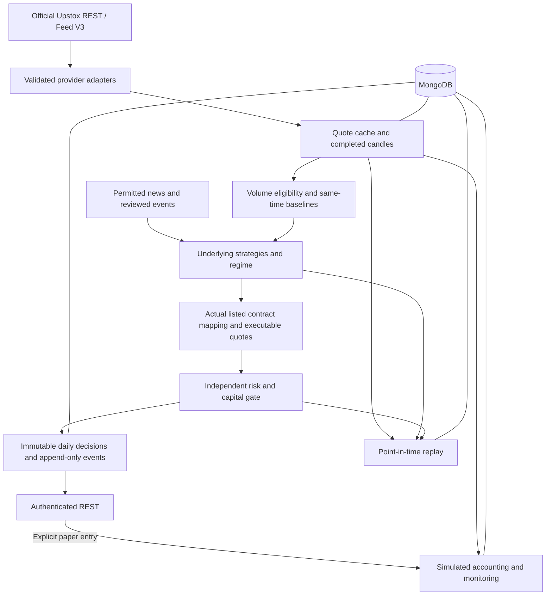

# Architecture

One Node.js service owns market-data subscriptions, research orchestration, authenticated REST and paper accounting. MongoDB is the sole persistent database; no Redis, PostgreSQL, Firebase, notifications or order execution is required.

## Boundaries and data provenance

`providers/upstox.ts` exposes explicit GET-only methods. It throttles and retries transient failures, rejects malformed envelopes and never returns fixture data. `providers/feed.ts` loads the vendored official schema, requests binary `full` subscriptions, authorizes each new socket, resubscribes and monitors ping/data activity. Subscription priorities preserve active paper positions, underlyings, volume proxies and VIX ahead of optional strikes.

Domain objects carry `mode`, source/exchange timestamps and receipt timestamps. Quotes distinguish response generation from last trade time. Both are checked before entry/exit. Chain responses have no source quote time: they supply Greek context but cannot independently authorize execution. OI update time stays null when the source does not provide it; reception time is never relabelled as OI exchange time.

The in-memory fixture store is a deliberately nonpersistent demo/test cache, not a second production database. Live configuration rejects it. A persistent database records its data mode and cannot be reused across demo and live startup.

## Candle and volume rules

The cumulative tracker never treats the first observed cumulative total as interval volume. It detects session resets, backward corrections, duplicates, out-of-order observations and gaps. Crossing a minute boundary makes volume allocation uncertain until exchange OHLC/reconciliation replaces it. The exact allocation of trades inside a gap is not knowable from two cumulative observations.

An aggregate requires every constituent minute exactly once, completed, contiguous and received by the as-of time. Its close must be at or before analysis. Missing intervals are not filled with flat prices or zero volume. Locally sampled tick OHLC is explicitly flagged and cannot qualify a research signal. Provider OHLC has priority. Scheduled intraday REST reconciliation repairs startup gaps and disconnects. Five-, fifteen- and thirty-minute windows are anchored to the verified session opening. Historical special-session aggregation uses stored session timings when available; otherwise only the normal session window is attempted.

Candle identity is instrument/interval/start, independent of whether the same observation later arrives through historical REST. Repeated identical observations retain their first receipt time. Corrections receive a new availability time; previous decision snapshots remain unchanged. Mutable candle storage does not preserve every superseded revision, so replay can become insufficient when an original observation has been replaced. Daily REST bars become eligible at the next IST midnight because the payload does not supply an explicit finalization time. Current-session daily feed bars are not treated as complete.

The Volume Intelligence Engine compares matching symbol, IST minute and interval length against distinct prior valid sessions. It excludes today's samples, future receipts, invalid observations and mixed synthetic/live sources. Missing/zero baselines yield null. Volume feature responses include method, sample counts, timestamps and limitations. Full-day RVOL uses completed daily observations; partial opening volume is never compared with full historical days.

## Strategies, scenarios and admission

Technical functions implement SMA, seeded EMA, Wilder RSI/ATR/ADX, MACD, Bollinger bands, support/resistance, momentum and candle VWAP. The registry contains versioned opening-participation research and an EMA/price-structure baseline without the volume gate. Regime restrictions reject unsupported/high-volatility/news-driven contexts rather than forcing a direction.

At 09:20, a mature directional opening candle plus independent EMA and volume confirmation may qualify. Later evaluations require a completed close beyond the opening range. Underlying invalidation is a structural opening-range boundary. Targets are measured-range hypotheses. Premium mapping uses local option delta/gamma and theta stress; excessive underlying moves, missing Greeks and invalid tick-rounded levels are rejected. No technique is assigned a claimed optimal weight or accuracy.

Ranking is lexicographic: same-time RVOL, net reward/risk, then spread. Risk admission independently enforces fresh data, depth for an actual lot, spread, volume, verified contract metadata, expiry, event coverage, cost verification, daily loss, capital and aggregate/correlated risk. Unvalidated sector correlations are not guessed: opportunities initially share a conservative India-equity exposure group. Accepted research candidates reserve risk/capital until expiry or terminal status; paper positions replace their corresponding reservations. Stale open-position marks are treated conservatively in the loss budget.

## MongoDB and concurrency

Mongoose uses explicit strict collection schemas. Analytical nested snapshots use `Mixed` only inside typed domain envelopes; all creation flows pass typed internal engines. Public requests cannot insert arbitrary signal or market records.

| Collections                                            | Main indexes / behaviour                                                  |
| ------------------------------------------------------ | ------------------------------------------------------------------------- |
| `private_accounts`, `risk_settings`                    | Singleton owner; account revision serializes risk/accounting transactions |
| `instruments`                                          | Unique ID; underlying/kind/expiry/active; trading symbol                  |
| `instrument_versions`                                  | Append-only metadata snapshots indexed by instrument/as-of                |
| `event_calendar_versions`                              | Append-only reviewed coverage and event snapshots indexed by receipt      |
| `market_candles`                                       | Unique instrument/interval/start; correctable regular collection          |
| `market_volume_profiles`                               | Unique instrument/interval/minute/day                                     |
| `option_snapshots`                                     | Instrument/source time; append-only; TTL date from configured retention   |
| `market_news`, `market_events`                         | Symbol/publication/retrieval and event-window indexes                     |
| `market_sessions`, `market_regimes`                    | Session date; underlying/as-of regime                                     |
| `analysis_runs`                                        | Trading day/actual time and day/report kind/scheduled time; immutable     |
| `trade_signals`                                        | Unique day/slot, day/underlying and day/contract; append-only             |
| `signal_events`                                        | Signal/time; append-only                                                  |
| `paper_trades`, `paper_trade_executions`               | Unique signal and request key; one execution per side                     |
| `data_ingestion_checkpoints`, `system_health`          | Persistent job IDs, lease expiry and health state                         |
| `strategy_definitions`, `strategy_versions`            | Current definitions and immutable version records                         |
| `backtest_runs`, `model_versions`, `model_performance` | Immutable evaluations / optional model metadata                           |

Mongo transactions use snapshot reads and majority writes. A shared account revision write causes conflicting admissions/fills to retry serially. Admission assigns slots inside the transaction; unique indexes provide a second barrier. A signal and initial lifecycle event commit with its report. Paper entry/exit, account cash and execution record commit together. Signals cannot be updated or deleted through the store or Mongoose mutation middleware; later outcomes are separate events.

Option snapshots remain ordinary collections because this implementation prioritizes deduplication and simple indexed replay. A future time-series migration must preserve receipt-time querying and original decision snapshots. Original signals, executions and analysis runs do not expire. Quote snapshots expire after `SNAPSHOT_RETENTION_DAYS`; extending retention and backups is necessary for longer replay windows.

## Scheduling and recovery

All session arithmetic uses `Asia/Kolkata`; storage timestamps are UTC milliseconds. NFO timings determine whether a session exists. Preparation is 30 minutes before the opening, premarket is 15 minutes before, first report is opening+5, subsequent reports are every 15 minutes, with every 30-minute follow-up labelled deep. Special sessions use the same relative offsets.

Workers claim durable task IDs with owner IDs and leases, renew every 20 seconds, record retries and skip completed work. Restart recovery rebuilds process-local state even if preparation already committed. Historical missed intermediate reports are not invented. Actual report time is separate from the scheduling objective. Repeated initial attempts are separate immutable records when completed opening data is delayed.

Use one running service process in the initial deployment. The database protects racing requests/jobs, but feed capacity, process-local rate limits and one-user broker connection limits still apply. A multi-process deployment would additionally need a single elected ingestion owner and shared request-rate accounting.

## Paper accounting and replay

Entry requires an explicit API request and stable `Idempotency-Key`, current ask, full quantity at best depth and entry-range/risk checks. It uses ask plus slippage and fees. A second request cannot average down or open a second daily position for the underlying. Exit uses a fresh observed bid minus slippage; a gap through the stop realizes the worse executable value. The first policy holds the whole lot until second target, stop, manual exit or session close.

An unfillable close remains an open unresolved position, with a degraded close health record. It is never assigned a fictitious closing price or zero P&L. Performance is calculated in realized exit order, after costs; open marks are nullable and explicitly freshness-labelled.

Replay calls the same strategy and risk functions. Decisions see only completed, received observations. Instrument and event-calendar versions are selected by their availability at the decision, including historical event removals. Entries use the next quote after the decision and must remain inside the requested replay interval. Missing option depth or point-in-time contract metadata leaves results insufficient. An unresolved exit stops further entries rather than freeing fictitious capital. The conservative OHLC helper explicitly labels ambiguous target-and-stop touches and uses the stop-first bound; the main replay uses observed quotes. No future news is allowed into historical context.

## Optional models and known boundaries

FinBERT is a configurable HTTP sentiment interface; an absent/failed service leaves sentiment null. `ValidatedModelService` is an optional inference contract that checks stored chronological-validation/calibration flags and returns null on any failure. No trained LightGBM model or validated probability model is supplied, and the shipped strategy does not call it to invent probabilities. Training, labels, walk-forward experiments and model approval require an adequate real historical dataset first.

The initial system does not claim validated sector-relative strength, licensed global macro coverage, automatic complete earnings-calendar coverage, a portfolio backtest optimizer, exercise/settlement simulation or broker-certified live throughput. These limitations are surfaced in `IMPLEMENTATION_STATUS.md` and research outputs where applicable.
